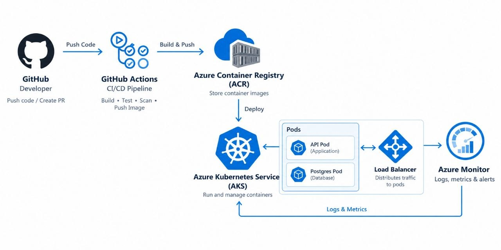

# GTECHGLOBAL OS — Production Deployment

> The operational backbone of GTECHGLOBAL — Architect · Build · Operate · Scale

A centralized business operating platform that unifies people, projects, products, clients, finances, technology, documents, workflows, and AI automation into one controlled environment.

---

## 🏗️ Application Stack
| Layer        | Technology                          |
|--------------|-------------------------------------|
| Web          | Next.js 14 · React 18 · TypeScript  |
| API          | NestJS 10 · TypeORM · PostgreSQL    |
| Cache        | Redis 7                             |
| Styling      | Tailwind CSS                        |
| Monorepo     | pnpm workspaces · Turborepo         |

---

## ☁️ DevOps Architecture & Deployment
This repository contains the complete Infrastructure as Code (IaC) and CI/CD pipeline to deploy this application to **Microsoft Azure**.

### Architecture Diagram

*Flow: GitHub ➔ GitHub Actions ➔ Azure Container Registry (ACR) ➔ Azure Kubernetes Service (AKS) ➔ Azure LoadBalancer*

### CI/CD Pipeline
I use **GitHub Actions** for a fully automated build and deploy process. On every push to the `master` branch, the pipeline:
1. Authenticates securely to Azure using a Service Principal.
2. Builds the API and Web multi-stage Docker images using `az acr build`.
3. Updates the Kubernetes manifests.
4. Deploys the ConfigMap, Postgres database, API, and Web apps to AKS.

### Kubernetes Highlights
- **High Availability:** 2 replicas each for the API and Web applications.
- **Resilience:** An `initContainer` ensures the API does not start until the PostgreSQL database is fully ready to accept connections.
- **Networking:** Public traffic is routed through Azure LoadBalancers.
- **Environment Config:** Injected securely via Kubernetes ConfigMaps.

---

## 🚀 Deployment Steps (How to reproduce)

**1. Provision Infrastructure via Terraform:**
```bash
cd terraform
terraform init
terraform apply
2. Configure GitHub Secrets:
Add your Azure Service Principal credentials to your GitHub repository as a secret named AZURE_CREDENTIALS.

3. Trigger the Pipeline:
Push any code change to the master branch. GitHub Actions will automatically build and deploy to AKS.

4. Verify Deployment:

bash
az aks get-credentials --resource-group VisualStudioOnline-1FA42575C2DD4E6791F652D30228ADB3 --name gtech-aks
kubectl get pods
kubectl get svc
📌 Design Decisions & Assumptions
Why Azure? While AWS was an option, Microsoft Azure was chosen to demonstrate multi-cloud competency and to ensure the project was delivered within the strict deadline.

Why AKS (Kubernetes)? AKS provides advanced orchestration, self-healing, and rolling updates compared to simpler services like Azure App Service.

Why GitHub Actions? Eliminates the need to host and maintain a dedicated Jenkins server while providing native integration with the repository.

⚠️ Limitations & Future Improvements
Database: For a true production environment, the in-cluster Postgres database should be migrated to Azure Database for PostgreSQL for managed backups and high availability.

Security: Environment variables containing secrets (like JWT_SECRET) should be moved from Kubernetes ConfigMaps to Azure Key Vault and injected using the Secrets Store CSI driver.

Ingress & SSL: Instead of using individual LoadBalancers for each service, an NGINX Ingress Controller should be deployed to route traffic and manage SSL/TLS certificates automatically.

Monitoring: Azure Monitor (Container Insights) or Prometheus/Grafana should be integrated for cluster observability.

💻 Local Development (Quick Start)
bash
pnpm install
cp .env.example apps/api/.env
cp .env.example apps/web/.env
docker compose -f docker/docker-compose.yml up -d
pnpm dev
Web: http://localhost:3000

API: http://localhost:4000

API Docs: http://localhost:4000/api/docs
